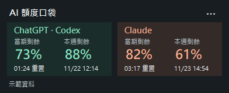

# AI 額度口袋 · AI Quota Pocket

把 ChatGPT（Codex）和 Claude 的剩餘額度與重置時間放在 Android 主畫面或 Windows 工具列附近。

| 平台 | 安裝檔 | 原始碼與說明 |
| --- | --- | --- |
| Android 8.0+（ARM64、x86-64） | [下載 APK 1.4.6](downloads/ai-quota-pocket-1.4.6.apk?raw=true) | [Android](android/) |
| Windows 10／11 | [下載 ZIP 0.2.2](downloads/ai-quota-pocket-windows-0.2.2.zip?raw=true) | [Windows](windows/) |
| iPhone | 開發參考 | [WidgetKit 移植說明](docs/ios-port.md) |

## 顯示與更新

- **Android** 提供 1×1、2×1 主畫面小工具。可用的時候，也能顯示透過桌面瀏覽器同步的 Gemini 快照。
- **Windows** 提供可收合到通知區的常駐小視窗。透過電腦上的官方 Codex CLI 和 Claude Code 讀取兩個週期的剩餘比例與重置時間，無需瀏覽器擴充功能。
- **資料格式** 可參考 [範例 JSON](docs/quota-snapshot.example.json)。缺少的額度顯示為「—」。顯示的比例對應各服務的訂閱額度。

## 授權

本專案的原創程式碼採 [MIT 授權](LICENSE)。Android 隨附的 PRoot、talloc 和上游檔案各自沿用原授權，詳見 [Android 執行層說明](android/runtime/README.md)。
